What a Wireshark capture of my own laptop taught me about SOC work

*Week 1 of my 90-day SOC analyst plan*

I spent my first week on networking fundamentals. The most useful part
wasn't a course room. It was capturing my own traffic on a normal home
network and asking what each pattern meant.

1\. HTTPS hides content, not destinations

I visited a plain-HTTP test site (neverssl.com) and an HTTPS site in the
same capture. Chrome itself warned me before sending anything.

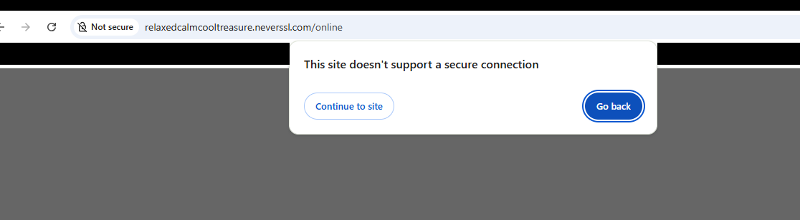

***Figure 1.** Chrome warns that neverssl.com doesn't support a secure
connection.*

Continuing past the warning loaded the site. This is what the browser
shows.

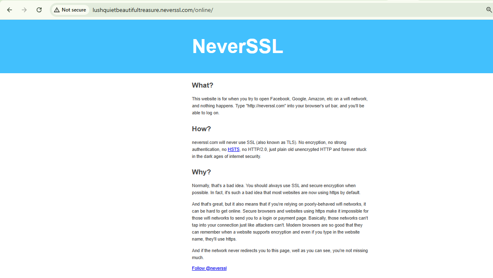

***Figure 2.** The neverssl.com page as rendered by Chrome, flagged "Not
secure".*

Filtering for http showed the request and the server's reply as plain,
readable packets.

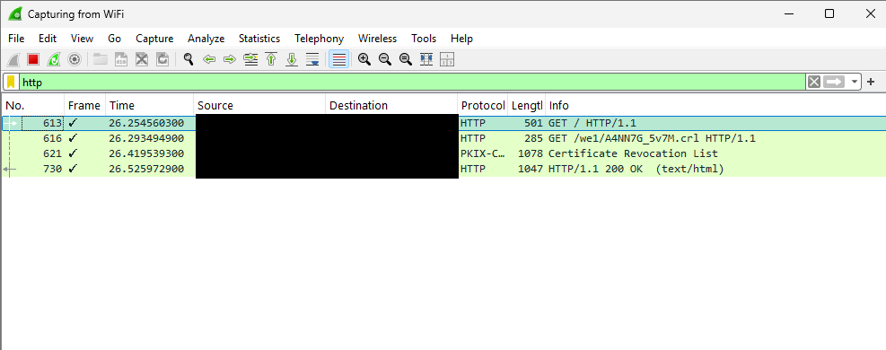

***Figure 3.** The http filter: a GET request and the server's 200 OK
response.*

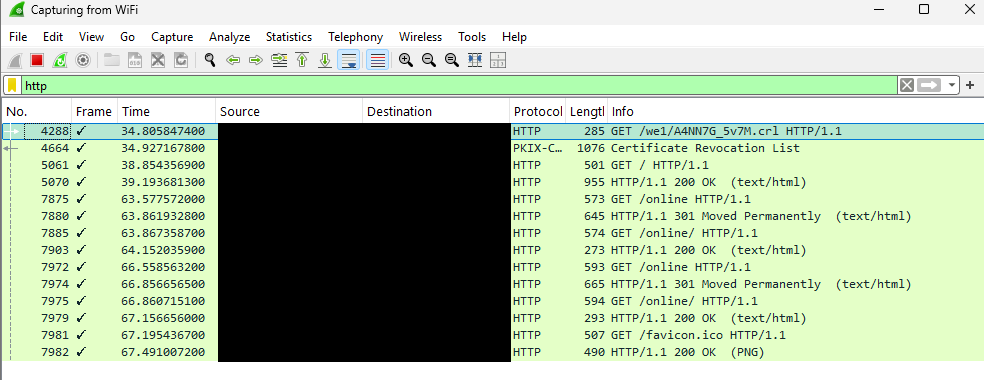

***Figure 4.** A longer capture also shows the redirect chain (301 Moved
Permanently) and the favicon fetch as separate packets.*

With Follow HTTP Stream, the session was fully readable: the request
headers, my exact browser and OS version, the server banner
(Apache/2.4.68), and the page body. If that had been a login form, the
credentials would have been equally readable.

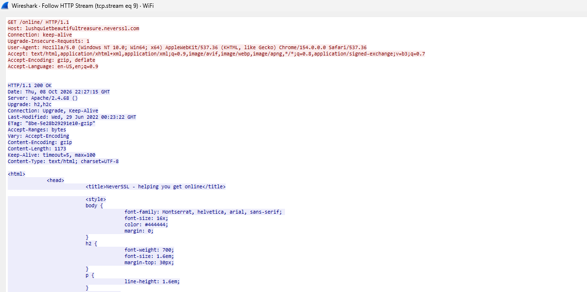

***Figure 5.** Follow HTTP Stream, top of the window: my request in red
and the server's response headers in blue, including the Apache server
banner.*

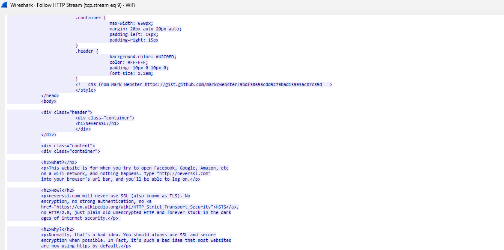

***Figure 6.** Further down the same stream: the page's HTML and CSS,
fully readable.*

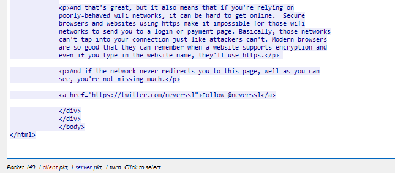

***Figure 7.** End of the stream: Wireshark reports 1 client packet, 1
server packet, 1 turn.*

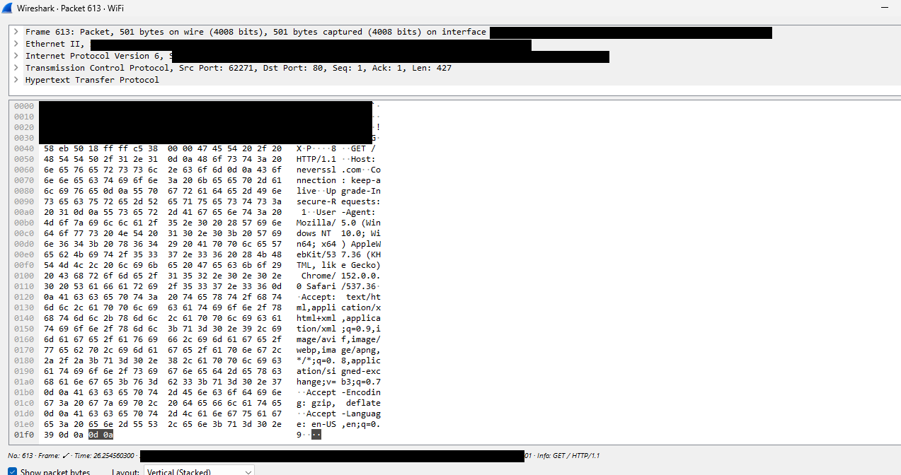

***Figure 8.** Raw bytes of the GET request: Host, User-Agent and Accept
headers, all in cleartext.*

By contrast, the same http filter on a browsing session that was
entirely HTTPS returned nothing to read.

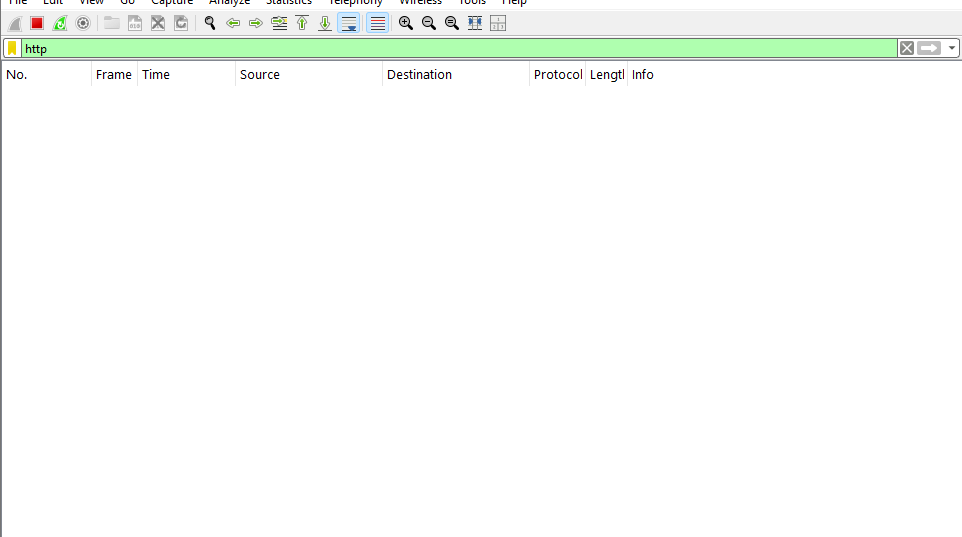

***Figure 9.** The http filter during an HTTPS-only session: empty.*

For the HTTPS connections, the content was encrypted. But filtering on
tls.handshake.type==1 showed the destination domain of every connection
in the ClientHello's SNI field, sent in plaintext. A SOC can log or
block by domain without decrypting anything, and an unfamiliar domain is
a natural place to start an investigation.

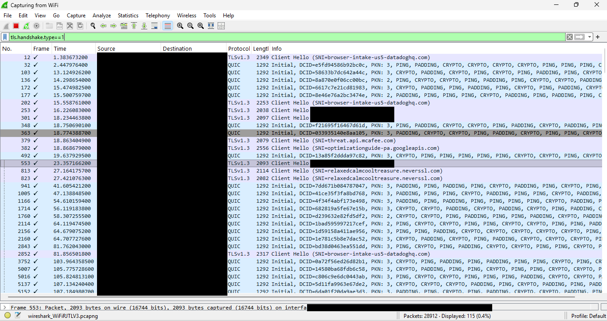

***Figure 10.** TLS ClientHello packets: the SNI field names each
destination even though the sessions are encrypted.*

2\. A top talker isn't automatically suspicious

In Statistics → Conversations, the Ethernet tab was dominated by one
pair: my machine and my router, which makes sense because everything
crosses that single hop.

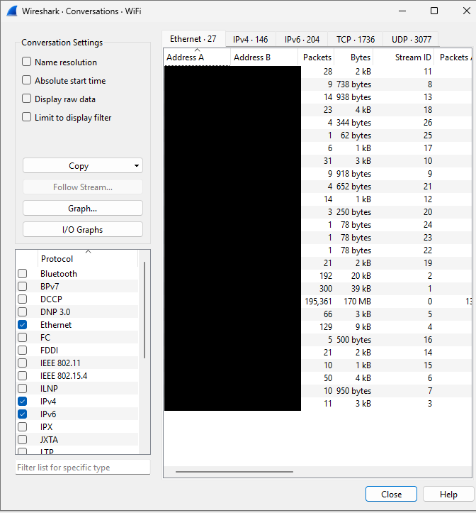

***Figure 11.** Conversations, Ethernet tab: one local pair carries
nearly all the bytes.*

The IPv4 tab was unremarkable: lots of small flows to cloud and CDN
addresses.

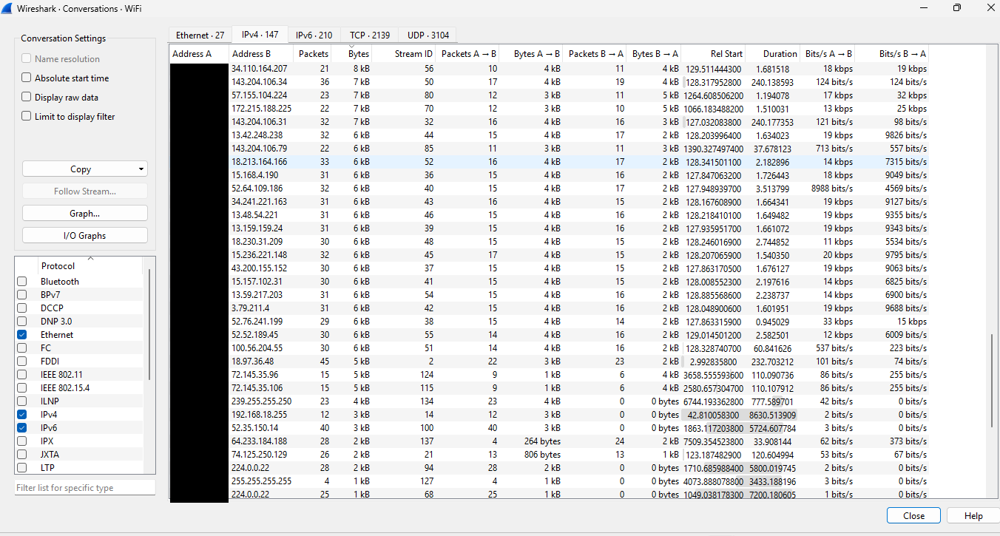

***Figure 12.** Conversations, IPv4 tab: every flow is small and similar
in size.*

The largest IPv6 conversation was a Google-owned address lasting about
two hours. It moved only about 155 KB. That pattern points to a
long-lived background connection, not bulk transfer. The patterns worth
a closer look would be a short connection moving a lot of data (possible
exfiltration), or a long one to an unfamiliar destination (possible
beaconing).

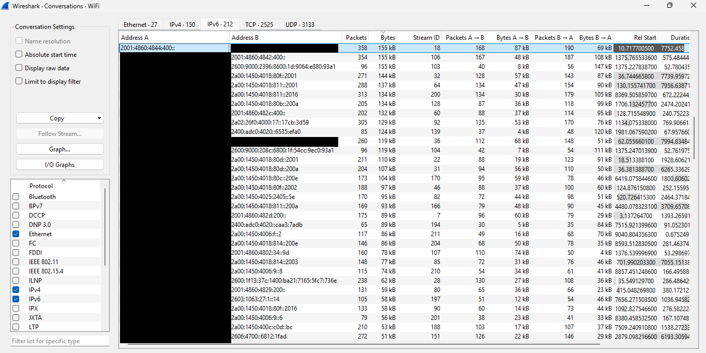

***Figure 13.** Conversations, IPv6 tab sorted by bytes: the top talker
is long-lived but low-volume.*

3\. DNS visibility is shrinking

My dns filter showed queries and responses, each response paired to its
query by transaction ID, and some responses carrying several answers.

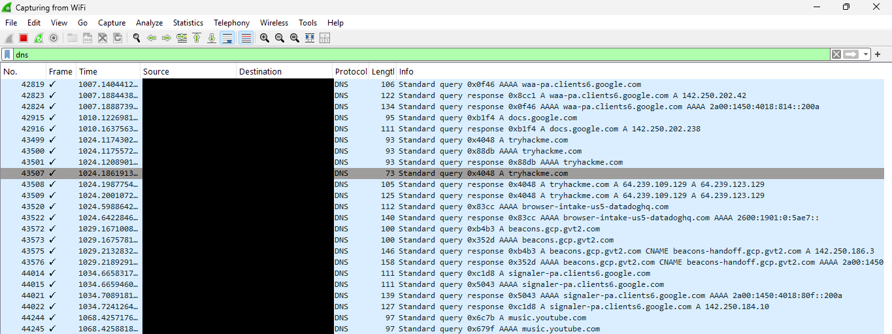

***Figure 14.** The dns filter: standard queries and their responses.*

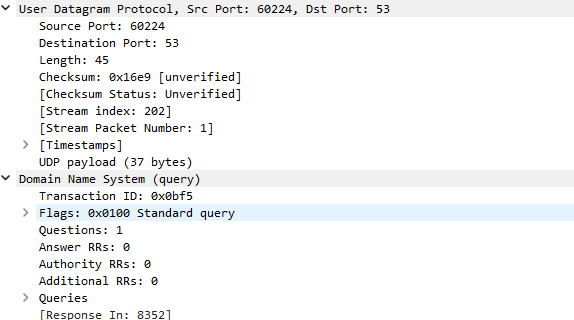

***Figure 15.** A DNS query up close: UDP, destination port 53, a
standard query.*

It showed fewer lookups than I'd expect from my browsing, though.
Chrome's "Use secure DNS" setting was on, so many lookups were happening
inside encrypted traffic. For defenders, this means DNS-based monitoring
can miss queries that DoH hides.

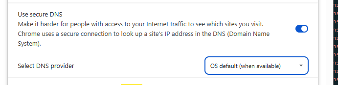

***Figure 16.** Chrome's "Use secure DNS" setting was enabled.*

I also found a repeated pattern of TCP retransmissions on port 53
between my machine and my router, which stood out against an isolated
retransmission on a 443 connection that looked like normal noise. My
working hypothesis is a struggling DNS-over-TCP path on the local
network. I haven't verified that. Next I'd check the router's DNS
behavior and compare against a different network.

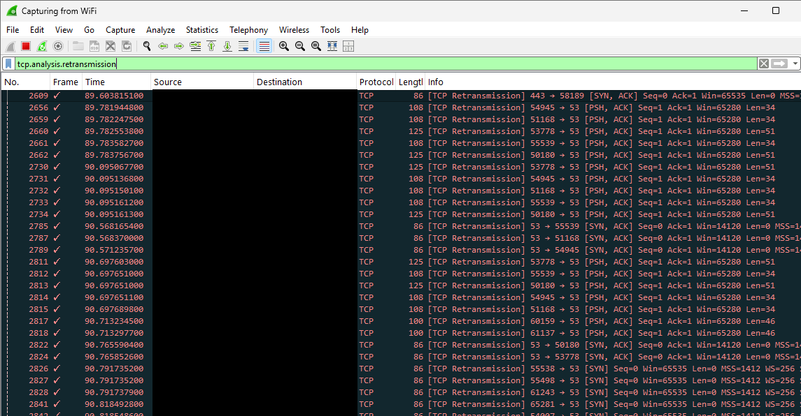

***Figure 17.** tcp.analysis.retransmission: repeated retransmissions on
port 53.*

4\. Know your tooling's quirks

About two-thirds of my packets showed up under an 802.1Q VLAN tag, on a
home network with no VLANs. This is most likely an artifact of the
capture driver, not a real finding.

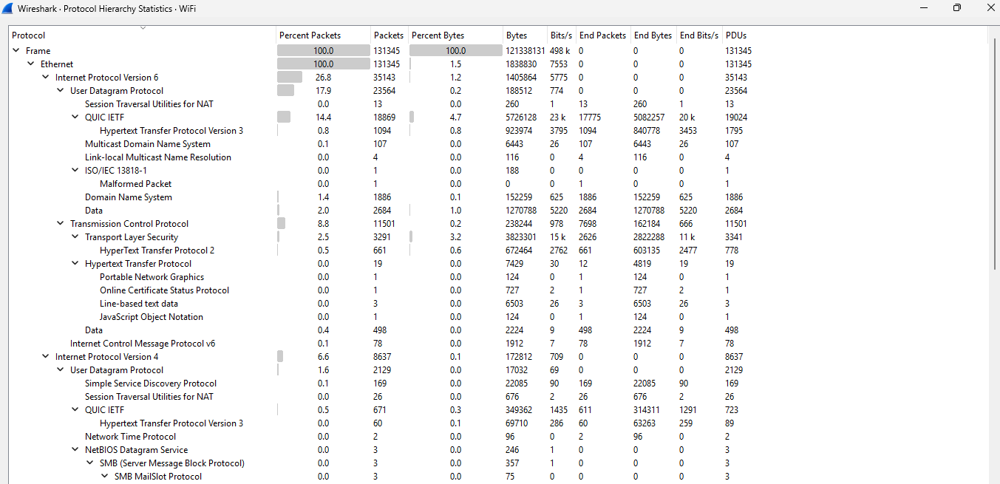

***Figure 18.** Protocol Hierarchy (top): QUIC and TLS make up most of
the traffic.*

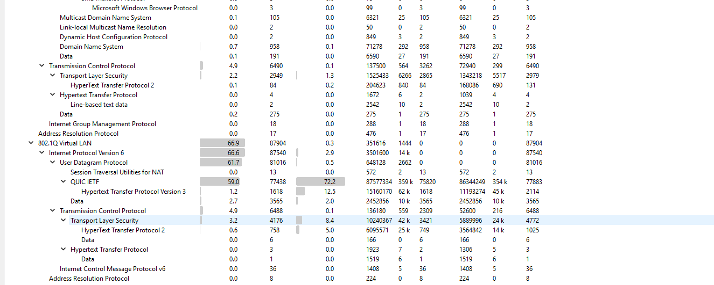

***Figure 19.** Protocol Hierarchy (bottom): the 802.1Q Virtual LAN
branch holds about two-thirds of all packets.*

I also missed an ARP exchange entirely because I generated the traffic
before starting the capture. I cleared the ARP cache and pinged the
gateway first:

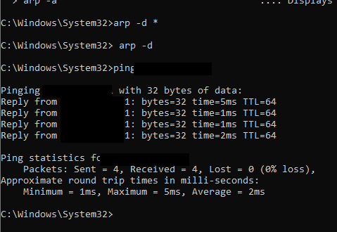

***Figure 20.** Clearing the ARP cache and pinging the gateway, before
the capture was running.*

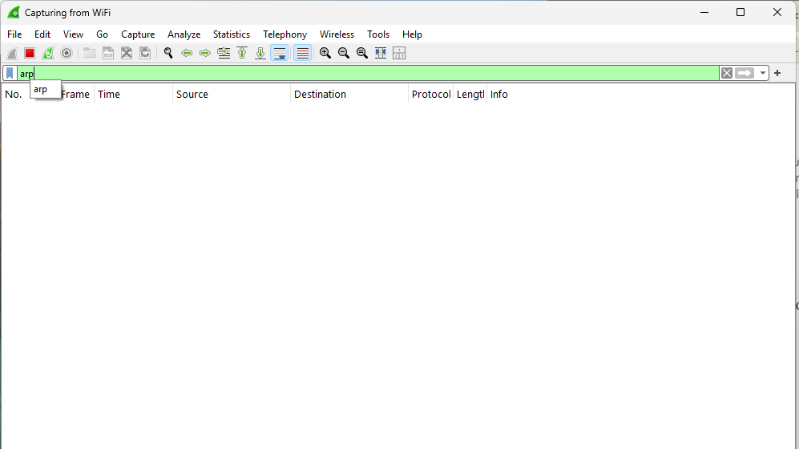

***Figure 21.** The arp filter on that capture: empty.*

With the capture started first, the ARP broadcasts showed up. Wireshark
only sees what happens while it's recording.

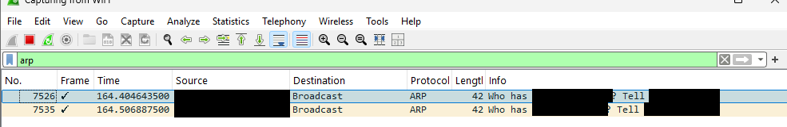

***Figure 22.** Capture started first: ARP "Who has ...? Tell ..."
broadcasts.*

Filters I'm adding to my toolkit

contains, matches (regex), in (e.g. tcp.port in {80 443 8080}), and
upper()/lower() for case-insensitive hunting, which are what you reach
for when you have a vague lead instead of an exact value.

Next

Week 2: Windows event logs and Sysmon.
